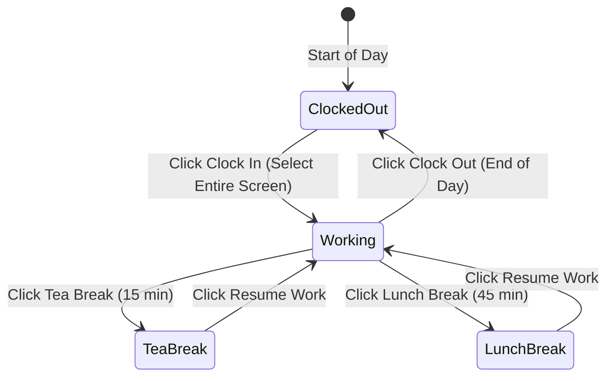
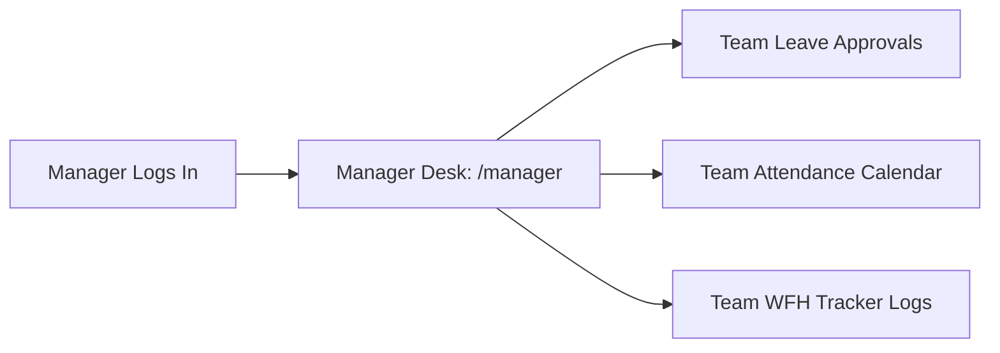

# HRM Pilot (CRM-DS) — Non-Technical User Manual & Operational Guide

**Audience:** Employees, Department Managers, HR Executives, and Company Leadership  
**Application:** HRM Pilot / CRM-DS Cloud Workforce Platform  
**Access Portal:** Web & Mobile Smartphone Compatible  

---

## 📖 Table of Contents
1. [Welcome to HRM Pilot](#1-welcome-to-hrm-pilot)
2. [User Roles & Access Levels](#2-user-roles--access-levels)
3. [Employee Portal Guide](#3-employee-portal-guide)
   - [Logging In & Device Memory](#logging-in--device-memory)
   - [Dashboard Overview](#dashboard-overview)
   - [Work From Home (WFH) Time Tracker Step-by-Step](#work-from-home-wfh-time-tracker-step-by-step)
   - [Office Biometric Attendance & Logs](#office-biometric-attendance--logs)
   - [Applying for Leaves & Checking Leave Balance](#applying-for-leaves--checking-leave-balance)
   - [Help, Complaints & Support Desk](#help-complaints--support-desk)
   - [Changing Your Password](#changing-your-password)
   - [Using HRM Pilot on Mobile Phones](#using-hrm-pilot-on-mobile-phones)
4. [Manager Desk Guide](#4-manager-desk-guide)
   - [Monitoring Team Attendance](#monitoring-team-attendance)
   - [Approving & Rejecting Team Leave Requests](#approving--rejecting-team-leave-requests)
   - [Overseeing Team Time Tracking](#overseeing-team-time-tracking)
5. [HR Administrator Suite Guide](#5-hr-administrator-suite-guide)
   - [Employee Directory & Onboarding Staff](#employee-directory--onboarding-staff)
   - [Branches & Shift Schedules (8h vs 9h Shifts)](#branches--shift-schedules-8h-vs-9h-shifts)
   - [Biometric Attendance & Monthly Excel Import](#biometric-attendance--monthly-excel-import)
   - [Leave Administration & Quota Adjustments](#leave-administration--quota-adjustments)
   - [WFH Live Board, Timesheets & Screenshots](#wfh-live-board-timesheets--screenshots)
   - [Handling Complaints & Support Tickets](#handling-complaints--support-tickets)
   - [Payroll Preview & Holiday Calendar](#payroll-preview--holiday-calendar)
   - [Company Branding & Logo Upload](#company-branding--logo-upload)
   - [1-Click Database Save & Backup](#1-click-database-save--backup)
6. [Super Admin Guide (Multi-Company Workspaces)](#6-super-admin-guide-multi-company-workspaces)
7. [Frequently Asked Questions (FAQ) & Troubleshooting](#7-frequently-asked-questions-faq--troubleshooting)

---

## 1. Welcome to HRM Pilot

**HRM Pilot** is a modern workforce management platform designed to make daily work tracking, attendance, leave management, and communication completely seamless. 

### Why Dark Mode?
The platform uses a sleek, modern **Dark Mode** design that reduces eye strain during long working hours, saves battery life on mobile OLED screens, and provides clear visual badges for attendance, breaks, and approvals.

### Universal Device Support
You can use HRM Pilot on any device:
- **Desktop & Laptops**: Google Chrome, Apple Safari, Microsoft Edge, Mozilla Firefox.
- **Smartphones**: Fully optimized for iPhone (iOS Safari) and Android (Chrome) with full-screen view and quick thumb navigation.

---

## 2. User Roles & Access Levels

| Role | Who Is This For? | What Can You Do? |
| :--- | :--- | :--- |
| **Employee** | All staff members & team contributors | Track daily work, clock in/out, view punch records, apply for leaves, check leave quotas, file complaints/feedback, change password. |
| **Manager** | Team leads, Department heads, Project managers | All employee features **PLUS**: View subordinate attendance, approve or reject team leaves, and monitor team tracking. |
| **HR Admin** | HR Executives, Operations, Directors | Complete management: Onboard employees, manage passwords, import biometric Excel sheets, review WFH live board & screenshots, manage payroll, upload company logo. |
| **Super Admin** | Company Owners & Platform Executives | Full administrative power **PLUS**: Manage multiple corporate workspaces/companies and switch between companies instantly. |

---

## 3. Employee Portal Guide

### Logging In & Device Memory

1. Open your company’s login page (e.g., `https://your-domain.com/login`).
2. Enter your **Work Email** or **Employee ID** (e.g., `SG012` or `sonu.digitalsuncity@gmail.com`).
3. Enter your **Password**.
4. **Convenient 1-Click Device Login**:
   - Check the box **`[✓] Save password on this device`** if you are on your personal laptop or phone.
   - The next time you open the login page, you will see a personalized **"Saved on This Device"** card. Simply click **"Sign in as [Your Name]"** for 1-click access!
   - You can click the **Eye icon** to view your password.
   - If someone else needs to sign in on your device, click **"Sign In with a Different Account"**.
   - If you sell or lend your device, click **"Forget this Device"** to erase saved credentials.

---

### Dashboard Overview

Once logged in, your **Employee Portal** opens automatically:
- **Top Greeting**: Shows your name, employee code, department, and branch.
- **Today's Working Clock**: Shows your live elapsed working time and whether your status is *Working*, *On Break*, or *Clocked Out*.
- **Quick Action Buttons**: Fast 1-tap buttons to start your WFH tracker or apply for a leave.
- **Leave Balance Cards**: Displays your available Casual and Planned leave days remaining for the active quarter.
- **Recent Attendance Feed**: Lists your check-in and check-out times for the current month.

---

### Work From Home (WFH) Time Tracker Step-by-Step

If you work remotely or your company uses time tracking, follow this simple daily workflow:

#### Step 1: Clocking In (Starting Your Day)
1. On your Dashboard, find the **Time Tracker** widget.
2. Click the prominent green **`Clock In`** button.
3. Your browser will prompt you to share your screen.
   > [!IMPORTANT]
   > **Company Policy: You MUST select "Entire Screen"**.  
   > In the browser dialog, click the **"Entire Screen"** tab, select your monitor thumbnail, and click **Share**.  
   > *If you select a single application window or browser tab, the system will reject it and ask you to select Entire Screen.*
4. Once shared, your timer begins ticking immediately!
5. **Chrome's Bottom Notification Bar**: Chrome will show a bottom bar saying *"HRM is sharing your screen [Stop sharing] [Hide]"*.  
   👉 **You can safely click "Hide"** to tuck the bar away. Clicking "Hide" will NOT interrupt your tracking.

#### Step 2: Taking a Break (Tea Break & Lunch Break)
1. You have two company-standard break options:
   - **Tea Break**: 15 minutes.
   - **Lunch Break**: 45 minutes.
2. Click the desired break button.
3. Your working timer will pause, screenshots are paused, and a break timer will start.
4. When you are ready to work again, simply click **`Resume Work`**.
   - *You do not need to re-share your screen. The tracker automatically resumes with zero extra clicks.*

#### Step 3: Clocking Out (End of Day)
1. When your workday is complete, click the red **`Clock Out`** button.
2. Your session closes immediately, the timer freezes, and your worked hours are saved.

---

### Office Biometric Attendance & Logs

If you work from the office, your attendance is recorded by the physical fingerprint/face scanner at the office entrance:
1. Navigate to the **Attendance** tab in your portal.
2. The calendar displays every day of the month:
   - 🟢 **P (Present)**: On-time check-in and full working hours completed.
   - 🟡 **HD (Half Day)**: Partial shift completed.
   - 🔴 **A (Absent)**: No punch recorded on a working day.
   - 🔵 **WO (Weekly Off)**: Your scheduled rest days (Sunday, or Saturday & Sunday).
   - 🟣 **H (Holiday)**: Official company holiday.
3. You can review your exact check-in and check-out timestamps and total hours completed.

---

### Applying for Leaves & Checking Leave Balance

#### Understanding Your Leave Balances
Every employee has quarterly leave allowances:
- **Casual Leave (CL)**: For personal errands, short emergencies, or appointments.
- **Planned Leave (PL)**: For vacations, weddings, or pre-scheduled travel.
- **Sick Leave (SL)**: For medical recovery.
- Your dashboard displays: **`Available / Total Allowance`** (e.g. `5 / 6 Days Remaining`).

#### Step-by-Step Leave Application
1. Click **`Apply Leave`** in the top navigation or the elevated button on your mobile bottom bar.
2. Fill out the application form:
   - **Leave Type**: Select Casual Leave, Planned Leave, or Sick Leave.
   - **Duration Type**: Select **Full Day**, **First Half**, or **Second Half**.
   - **Date Range**: Select Start Date and End Date.
   - **Handover Notes**: Mention who is covering your responsibilities while you are away.
   - **Emergency Contact**: Provide a phone number where you can be reached if needed.
   - **Reason**: Brief explanation for the leave request.
3. Click **`Submit Leave Application`**.
4. You will automatically be taken to your **Leave History** tab where you can monitor real-time approval status:
   - ⏳ *Pending Approval* ➔ Waiting for Manager review.
   - ⏳ *Pending HR Approval* ➔ Approved by Manager, awaiting HR final sign-off.
   - 🟢 *APPROVED BY BOTH ✓* ➔ Fully approved!

---

### Help, Complaints & Support Desk

HRM Pilot includes a direct, confidential channel to HR for assistance, suggestions, or complaints:

1. Click on the **`Help & Support`** tab.
2. Choose a category:
   - 🛑 **Complaint**: Confidential matters sent directly to HR leadership.
   - 💡 **Suggestion**: Ideas for company improvement, operations, or workplace culture.
   - 💬 **Feedback**: Thoughts on team collaboration, tools, or work environment.
   - 🛠️ **Help / Support**: Technical difficulties, attendance correction requests, or HR queries.
3. Enter a **Subject** and detailed **Description**.
4. **Attach a Screenshot**:
   - Drag and drop or browse for an image (PNG, JPG, WEBP up to 5 MB).
   - Useful for showing software errors or punch machine issues.
5. Click **`Submit Request`**.
6. Under **"My Submitted Requests"**, you will see your ticket status (`Pending` ➔ `In Review` ➔ `Resolved`) along with any written reply from HR!

---

### Changing Your Password

1. Click on your profile name or avatar in the top right corner.
2. Select **`Change Password`**.
3. Enter your **Current Password**, then type and confirm your **New Password**.
4. Click **`Save Password`**.
5. Your password updates immediately across the server, and if you saved it on your device, it automatically updates your device memory too!

---

### Using HRM Pilot on Mobile Phones

HRM Pilot has been custom-crafted for a fluid, native-app feel on smartphones:
- **Fixed Bottom Navigation Bar**: 5 quick-touch actions right under your thumb:
  1. 🏠 **Home**: Quick jump to your Dashboard.
  2. 📅 **Attendance**: View your daily attendance timeline.
  3. ➕ **Apply**: Elevated center button to apply for leaves in 1 tap.
  4. 📋 **History**: Instant check on pending leave approvals.
  5. ☰ **Menu**: Opens the slide-in menu for Profile, Holidays, and Logout.
- **Vertical Schedule Cards**: Attendance grids and leave tables automatically render as clean, vertical cards that fit your phone screen with **zero horizontal scrolling**!

---

## 4. Manager Desk Guide

If you are a Department Manager or Team Lead, you have access to the **Manager Desk** (`/manager`).

### Monitoring Team Attendance
1. From the Manager Desk, open the **Team Attendance** view.
2. View your subordinates' daily check-ins, check-outs, absences, and late marks.
3. Filter by individual team members to review their monthly hours.

### Approving & Rejecting Team Leave Requests
1. Open the **Team Approvals** tab.
2. You will see a list of all pending leave applications submitted by your team.
3. Review the leave type, dates, reason, and handover notes.
4. Take action:
   - Click **`Approve (Manager)`**: Advances the request to HR for final sign-off.
   - Click **`Reject`**: Declines the request with an optional note to the employee.
5. On mobile phones, approvals appear as touch-friendly cards with instant 1-tap action buttons.

---

## 5. HR Administrator Suite Guide

The **HR Admin Suite** (`/admin`) is the central control room for workforce operations.

### Employee Directory & Onboarding Staff
1. Open **`Employees`** from the Admin sidebar.
2. View all company employees as visual cards or detailed tables.
3. **Onboarding a New Employee**:
   - Click **`+ Add New Employee`**.
   - Fill in: Full Name, Work Email, Employee Code (e.g. `DS025`), Department, Designation, and Monthly Salary.
   - **Branch Assignment**: Choose *Main Branch* (8h shift, Sunday off) or *SEO Branch* (9h shift, Sat & Sun off).
   - **Work Mode**: Choose *Office* or *WFH* (enables automated time tracker).
   - **Initial Password**: Set a temporary password (default: `Employee@123`).
   - Click **`Save Profile`**.
4. **Editing or Deactivating**:
   - Tap any employee card to edit their profile, change their shift target, or toggle their status between `ACTIVE` and `INACTIVE`.

---

### Branches & Shift Schedules (8h vs 9h Shifts)
HRM Pilot supports flexible branch structures:
- **Main Branch (HQ)**:
  - 8-hour total shift (7 hours actual work + 1 hour break).
  - 1 weekly off day (Sunday).
- **SEO Digital Branch**:
  - 9-hour total shift (8 hours actual work + 1 hour break).
  - 2 weekly off days (Saturday & Sunday).
- To manage branches, open **`Admin` ➔ `Branches`**. You can add new branches, configure shift hours, and assign staff.

---

### Biometric Attendance & Monthly Excel Import
1. Download the raw punch report from your biometric machine as an `.xlsx` or `.xls` file.
2. Open **`Admin` ➔ `Attendance` ➔ `Import Monthly Attendance`**.
3. Select the file and click **`Upload & Process Attendance`**.
4. **Intelligent Name Matching**:
   - The system automatically matches employees by full name using smart phonetic matching.
   - Misaligned hardware ID numbers will never scramble your employee records.
5. **Manual Punch Corrections**:
   - If an employee forgot to punch in or experienced an outdoor assignment, open the **Attendance Log**, click on that day's entry, enter the corrected check-in/out times and a reason, and click **`Save Correction`**.

---

### Leave Administration & Quota Adjustments
1. Open **`Admin` ➔ `Leave Records`**.
2. **Pending Approvals**:
   - Review pending requests.
   - Click **`Approve (HR)`** to grant final approval. Both the manager badge and HR badge will turn green (`APPROVED BY BOTH ✓`).
3. **Manual Leave Adjustments**:
   - Click **`⚖️ Adjust Employee Leave`**.
   - If an employee worked extra days or needs special allowance coverage, select the employee, enter the adjustment days, and submit.
   - This adjusts the employee's available leave balance without tampering with official biometric punch logs.

---

### WFH Live Board, Timesheets & Screenshots

Open **`Admin` ➔ `Time Tracking`** to access the complete WFH management suite:

1. **Live Board**:
   - Real-time view of all remote employees.
   - Color badges indicate: 🟢 **Working** (live clock ticking), ☕ **Tea Break**, 🍱 **Lunch Break**, or ⚪ **Clocked Out**.
   - **Admin Force Clock Out**: If an employee forgot to clock out at the end of their shift, click **`Clock Out`** on their card to close their session immediately.
2. **Screenshots Gallery**:
   - View captured screenshots for any employee and date.
   - Thumbnails show the exact date, time, and resolution.
   - Click any thumbnail to inspect the full-resolution screenshot in a lightbox.
   - Old screenshots are **automatically deleted after 7 days** to keep storage clean.
3. **Timesheets & CSV Exports**:
   - Complete breakdown: *Logged-in Time*, *Break Deductions*, *Net Worked Hours*, *Target Hours*, and *Overtime (+OT)*.
   - Click **`Summary CSV`** or **`Detailed CSV`** to export monthly timesheet data directly to Excel for payroll processing.

---

### Handling Complaints & Support Tickets
1. Open **`Admin` ➔ `Feedback Desk`** (`/admin/feedback`).
2. Filter tickets by **Pending**, **In Review**, or **Resolved**.
3. Inspect employee descriptions and click any attached screenshot to open the image viewer.
4. Update the ticket status via the dropdown.
5. Click **`Reply`** to type an administrative response note that appears directly on the employee's portal!

---

### Payroll Preview & Holiday Calendar
- **Payroll (`/admin/payroll`)**: Calculates gross salary, working day deductions, unpaid leave penalties, and net payable salary for every employee based on verified biometric attendance. Exportable to Excel.
- **Holidays (`/admin/holidays`)**: Add and manage official annual holidays. Holidays automatically mark attendance grids with a festive purple `H` badge and exempt employees from working requirements.

---

### Company Branding & Logo Upload
1. Open **`Admin` ➔ `Settings`** (`/admin/settings`).
2. Under **Company Brand & Logo**, drag and drop your corporate logo image (PNG, JPG, SVG, WEBP up to 5 MB).
3. The logo updates immediately across the **Top Navigation Bar**, **Login Screen**, and **Mobile Menu**!

---

### 1-Click Database Save & Backup
Whenever you make important changes to staff rosters, leave approvals, or attendance corrections:
1. Look at the top navigation bar.
2. Click the green **`💾 Save Database`** button.
3. The system flushes all changes, creates a secure timestamped snapshot in `data/backups/`, and displays a confirmation toast showing synced record counts.

---

## 6. Super Admin Guide (Multi-Company Workspaces)

For multi-tenant conglomerates and agency owners managing multiple companies:

1. Log in with a `SUPER_ADMIN` account.
2. In the top navigation bar next to the logo, you will see the **Workspace Switcher** dropdown.
3. Click to switch instantly between **Digital Suncity**, **Apex Global**, or any client workspace with **0-second reload**.
4. Open **`Admin` ➔ `Companies`** (`/admin/companies`) to:
   - View global employee counts across all tenants.
   - Click **`+ Add New Company`** to onboard a new corporate workspace with custom shift hours, weekly off rules, and designated company admins.

---

## 7. Frequently Asked Questions (FAQ) & Troubleshooting

### Q1: The browser blocked or cancelled my screen share during Clock In. What should I do?
> **Answer**: Screen sharing is required by company policy for remote tracking. If you accidentally cancelled or chose a single window, simply click **`Clock In`** again, choose the **"Entire Screen"** tab in the browser prompt, and click **Share**.

### Q2: Chrome shows a bar at the bottom saying "HRM is sharing your screen". Can I hide it?
> **Answer**: Yes! Click the **"Hide"** button on the bottom bar. It will safely disappear and your tracking will continue uninterrupted. Do NOT click *"Stop sharing"* unless you want to end your workday.

### Q3: Why is my Time Tracker worked time different from my Biometric Attendance?
> **Answer**: They are kept strictly separate by design:
> - **Biometric Attendance** is your official attendance record from the office biometric scanner used for formal payroll and attendance compliance.
> - **Time Tracker** measures your active remote working sessions, tea/lunch breaks, and overtime for WFH shifts.

### Q4: I forgot my password or cannot log in.
> **Answer**: Contact your HR Administrator. HR Admins can view or reset passwords instantly from the Employee Directory in the Admin Suite.

### Q5: How do I install HRM Pilot on my mobile phone's Home Screen?
> **Answer**:
> - **On iPhone (Safari)**: Open the portal URL, tap the **Share** button (box with upward arrow) at the bottom, and select **"Add to Home Screen"**.
> - **On Android (Chrome)**: Tap the three dots menu at the top right and select **"Install app"** or **"Add to Home screen"**.
> - You now have a full-screen app icon on your phone!

### Q6: Why did my attendance schedule change from a wide table to a vertical list on my phone?
> **Answer**: Wide 31-day tables require over 1,300 pixels of width and force awkward horizontal scrolling on phones. HRM Pilot automatically transforms the table into an intuitive vertical day-by-day calendar timeline on mobile devices, making it effortless to review your days with a simple scroll!
