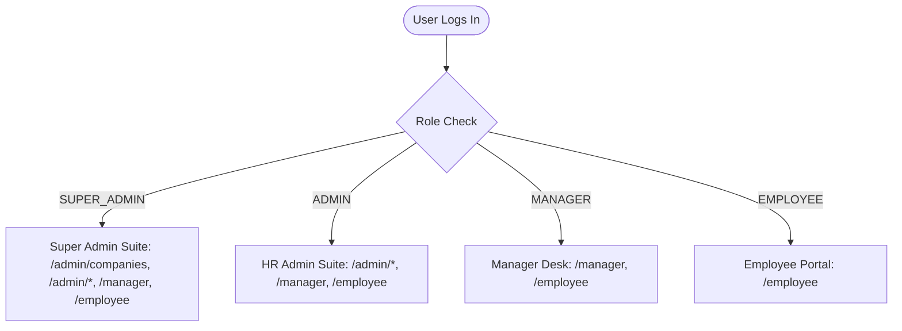

# HRM Pilot (CRM-DS) — Master Documentation Hub

Welcome to the comprehensive documentation repository for **HRM Pilot (CRM-DS)**. This directory contains complete, up-to-date documentation tailored for software engineers, DevOps administrators, HR managers, department leads, and employees.

---

## 📚 Documentation Directory

| Document | Target Audience | Primary Contents |
| :--- | :--- | :--- |
| **[🌐 Interactive Documentation Portal (HTML Web App)](file:///d:/Ravina/Antigravity/crm-ds/public/documentation.html)** | **All Users (Technical & Non-Technical)** | **Full single-page documentation web portal (style of chat-pilot.edgeone.dev) with live search, copy buttons, dark/light toggle, Mermaid diagrams, API references, role guides, and WFH tracking walkthrough.** |
| **[Technical Documentation](file:///d:/Ravina/Antigravity/crm-ds/docs/TECHNICAL_DOCUMENTATION.md)** | Software Engineers, Architects, DevOps, QA | Architecture, Next.js 15 App router, Prisma schema, REST APIs, state sync engine, WFH screen monitoring, biometric matching, CI/CD pipelines, and deployment. |
| **[Non-Technical User Manual](file:///d:/Ravina/Antigravity/crm-ds/docs/NON_TECHNICAL_USER_MANUAL.md)** | Employees, Managers, HR Staff, Super Admins | Step-by-step workflows, role permissions, daily clock-in/out, WFH time tracking, leave requests, feedback desk, team approvals, and FAQs. |
| **[Project Handoff File](file:///d:/Ravina/Antigravity/crm-ds/HANDOFF.md)** | Engineering Leads, Successor Developers | Complete historical decisions, feature changelog, active migrations, and current operational status. |
| **[Hostinger Deployment Guide](file:///d:/Ravina/Antigravity/crm-ds/HOSTINGER_DEPLOYMENT.md)** | Systems Administrators, DevOps | Node.js Phusion Passenger configuration, zip extraction, SSH access, and environment setup. |
| **[Time Tracker v3 Guide](file:///d:/Ravina/Antigravity/crm-ds/DEPLOY_TIME_TRACKER_UPDATE.md)** | HR Directors & Developers | Break constraints (Tea 15m / Lunch 45m), overtime formulas, screen-sharing policies, and 7-day retention rules. |

---

## ⚡ Quick Start for Developers

```bash
# 1. Clone repository
git clone https://github.com/harsh12356-44/CRM-DS.git
cd CRM-DS

# 2. Install dependencies
npm install

# 3. Setup environment variables
cp .env.example .env
# Edit .env with your PostgreSQL / Supabase credentials

# 4. Generate Prisma Client
npx prisma generate

# 5. Start development server
npm run dev
# App will run at http://localhost:3000
```

---

## 👥 User Roles & Access Points

The application features 4 role tiers with automatic route redirection:



- **Employee Portal (`/employee`)**: Self-service attendance, punch clock, WFH time tracker, leave application, leave balance, complaints/feedback desk, profile.
- **Manager Desk (`/manager`)**: Subordinate leave approvals, team attendance monitoring, team timesheets.
- **HR Admin Suite (`/admin`)**: Employee directory, payroll calculation, biometric Excel import, attendance grid, company settings, leave management, feedback desk, WFH live board.
- **Super Admin (`/admin/companies`)**: Multi-company workspace management, global staff directory, company creation and branding.

---

## 🛡️ Key System Architecture Highlights

1. **Hybrid Persistence Architecture**: In-memory cache + persistent `data/db.json` storage + real-time non-blocking synchronization to **Supabase PostgreSQL** via **Prisma ORM**.
2. **Real-Time 0ms UI Updates**: Instant cross-tab and cross-window state propagation using browser `BroadcastChannel('crm_time_tracker_sync')`, custom window events, and optimistic UI mutations with rollback guards.
3. **Resilient Screen Monitoring Engine**: Uses browser `getDisplayMedia` with mandatory Entire Screen policy, DOM-attached hidden `<video>` element preventing Chromium background tab throttling, and randomized interval capture.
4. **Biometric Name Matching**: Strict full-name matching with Levenshtein fuzzy distance tolerance, avoiding machine ID collisions.
5. **Mobile First & PWA Ready**: Native touch targets (44px+), notch/safe-area support (`env(safe-area-inset-*)`), vertical calendar and timeline cards, and fixed thumb navigation bar.
